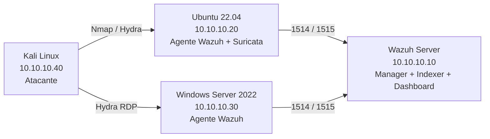
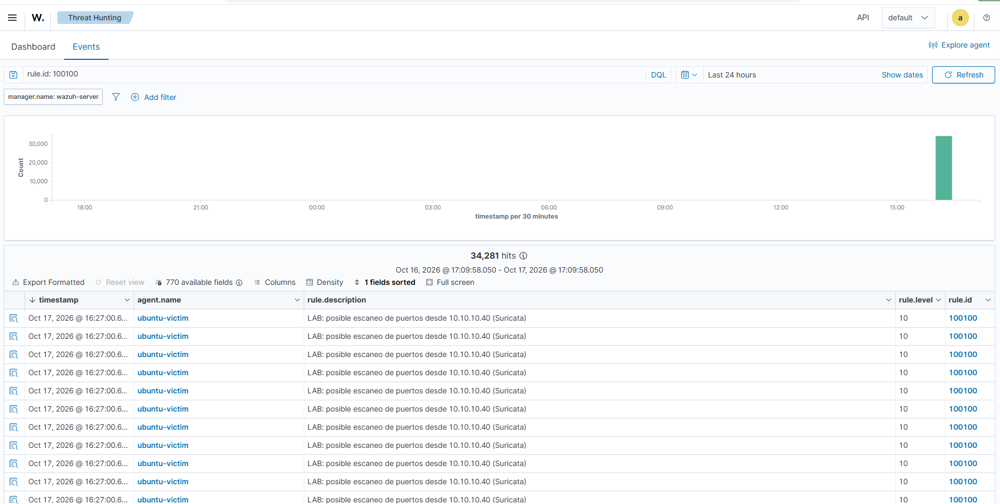
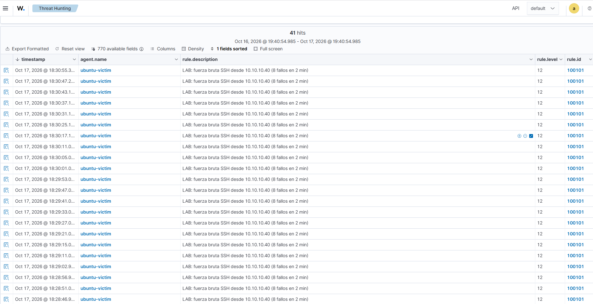
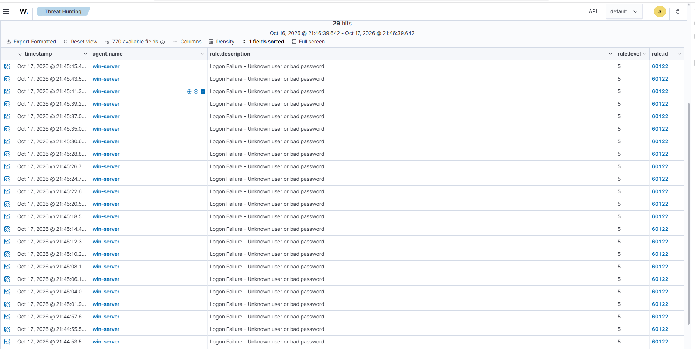
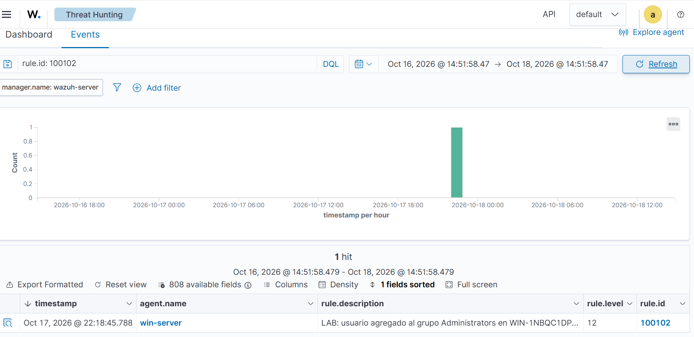

# Laboratorio SOC con Wazuh: detección de ataques y mapeo a MITRE ATT&CK

Laboratorio de ciberseguridad defensiva que simula el trabajo de un analista **SOC L1**: desplegar un SIEM/XDR (**Wazuh**), generar ataques controlados desde **Kali Linux**, detectarlos en un servidor Linux y en un Windows Server, escribir **reglas de detección propias**, mapear cada alerta a **MITRE ATT&CK** y documentar el triaje.

> **Autor:** Cristian Barrientos · [LinkedIn](#) · [GitHub](#)
> **Estado:** Completo — 4 de 4 escenarios detectados y documentados

---

## Objetivos

- Desplegar Wazuh (manager, indexer y dashboard) y conectar agentes Linux y Windows.
- Detectar fuerza bruta, escaneo de puertos y creación de cuentas privilegiadas.
- Escribir y probar reglas personalizadas (Wazuh y Suricata).
- Mapear alertas a técnicas MITRE ATT&CK y aplicar un análisis de triaje L1 (verdadero/falso positivo, severidad, escalamiento).
- Probar una respuesta activa que bloquea automáticamente la IP atacante.

## Arquitectura



Todo corre en VirtualBox sobre una **NAT Network** (`10.10.10.0/24`) aislada de la red doméstica.

| VM | Sistema | RAM | Rol |
|---|---|---|---|
| `wazuh-server` | Ubuntu Server 22.04 | 6 GB | Wazuh manager + indexer + dashboard (all-in-one) |
| `ubuntu-victim` | Ubuntu Server 22.04 | 2 GB | Víctima Linux: SSH, Apache, agente Wazuh, Suricata |
| `win-server` | Windows Server 2022 Evaluation | 3 GB | Víctima Windows: RDP, agente Wazuh |
| `kali-attacker` | Kali Linux | 2 GB | Generación de ataques |

## Requisitos

- Equipo con **16 GB de RAM** (32 GB ideal), 4 núcleos con virtualización activada y 150 GB libres.
- VirtualBox 7.x (o VMware Workstation).
- ISOs: Ubuntu Server 22.04 LTS, Windows Server 2022 Evaluation, imagen de VM de Kali Linux.
- Wazuh **4.14** (rama estable usada en este laboratorio).
- Conocimientos básicos de Linux, redes y lectura de logs.

## Instalación

La guía completa, con comandos y capturas, está en [`docs/guia-laboratorio-wazuh.pdf`](docs/guia-laboratorio-wazuh.pdf). Resumen:

1. **Red:** crear la NAT Network `SOCLab` (`10.10.10.0/24`, sin DHCP) y asignar IP fija a cada VM.
2. **Servidor Wazuh:** instalación all-in-one con el asistente oficial.

   ```bash
   curl -sO https://packages.wazuh.com/4.14/wazuh-install.sh
   sudo bash ./wazuh-install.sh -a
   ```

3. **Agentes:** desplegarlos en `ubuntu-victim` y `win-server` con el comando generado por el dashboard (**Agents → Deploy new agent**).
4. **Suricata** en `ubuntu-victim`, con su `eve.json` enviado a Wazuh ([`configs/agent-ubuntu-eve-json.xml`](configs/agent-ubuntu-eve-json.xml)).
5. **Reglas propias:** copiar [`rules/local_rules.xml`](rules/local_rules.xml) al servidor Wazuh y [`rules/local.rules`](rules/local.rules) a Suricata.
6. **Respuesta activa (opcional):** aplicar [`configs/active-response.xml`](configs/active-response.xml).

> Nunca subas al repositorio `wazuh-passwords.txt` ni las contraseñas del laboratorio.

## Reglas de detección personalizadas

| ID | Motor | Qué detecta | Nivel | MITRE ATT&CK |
|---|---|---|---|---|
| `1000001` | Suricata | Ráfaga de paquetes SYN (20 en 5 s desde una misma IP) | n/a | [T1046](https://attack.mitre.org/techniques/T1046/) |
| `100100` | Wazuh | Escalamiento de la alerta de Suricata anterior como posible escaneo de puertos | 10 | [T1046](https://attack.mitre.org/techniques/T1046/) |
| `100101` | Wazuh | 8 fallos de autenticación SSH en 2 minutos desde la misma IP | 12 | [T1110.001](https://attack.mitre.org/techniques/T1110/001/) |
| `100102` | Wazuh | Usuario agregado al grupo local `Administrators` en Windows (evento 4732) | 12 | [T1098](https://attack.mitre.org/techniques/T1098/) |

Los archivos completos están en [`rules/`](rules/).

## Escenarios de ataque y resultados

| # | Escenario | Comando (desde Kali) | Alertas generadas | MITRE ATT&CK |
|---|---|---|---|---|
| A | Escaneo de puertos | `nmap -sS -sV -p- -T4 10.10.10.20` | **34.281** alertas de Suricata, escaladas por la regla `100100` (nivel 10) | T1046 Network Service Discovery |
| B | Fuerza bruta SSH | `hydra -l labuser -P ~/pass.txt -t 4 ssh://10.10.10.20` | **41** alertas de la regla `100101` (nivel 12); contraseña comprometida: `sunshine` | T1110.001 Password Guessing |
| C | Fallos de logon RDP | `hydra -t 1 -l Administrator -P ~/pass30.txt rdp://10.10.10.30` | **29** alertas de la regla `60122` (nivel 5); 0 contraseñas válidas encontradas | T1110 Brute Force |
| D | Persistencia simulada en Windows | `net user labbackdoor "P@ssw0rd-Lab1" /add` y `net localgroup Administrators labbackdoor /add` (en la VM) | **1** alerta de la regla `100102` (nivel 12) | T1136.001 Create Account · T1098 Account Manipulation |

Los comandos están reunidos en [`scripts/escenarios-ataque.sh`](scripts/escenarios-ataque.sh). Se ejecutan **solo contra las VMs del laboratorio**.

## Resultados

| Escenario | Alertas observadas (regla · nivel) | ¿Disparó la regla propia? | Evidencia |
|---|---|---|---|
| A. Escaneo Nmap | `100100` · nivel 10 — 34.281 hits | Sí |  |
| B. Fuerza bruta SSH | `100101` · nivel 12 — 41 hits | Sí |  |
| C. Fallos RDP | `60122` · nivel 5 — 29 hits | No (umbral de agrupación no se cumplió con el diccionario corto; ver Lecciones aprendidas) |  |
| D. Cuenta con privilegios | `100102` · nivel 12 — 1 hit | Sí |  |

**Respuesta activa:** al disparar la regla `100101` con `<active-response>` habilitada, Wazuh bloquea la IP atacante (`10.10.10.40`) durante 3 minutos mediante `firewall-drop`, cortando el acceso SSH desde Kali en ese lapso.

## Ejemplo de análisis tipo L1

Plantilla aplicada a cada alerta relevante. Los análisis completos de las 4 alertas están en [`docs/analisis-alertas.md`](docs/analisis-alertas.md).

| Campo | Contenido |
|---|---|
| Alerta / regla | `100101` · LAB: fuerza bruta SSH (nivel 12) |
| Fecha y agente | 17 Oct 2026, 18:28–18:30 UTC · `ubuntu-victim` |
| Origen y destino | `10.10.10.40` → `10.10.10.20:22`, usuario `labuser` |
| Evidencia | 41 alertas en ~2 min; contraseña comprometida: `sunshine` |
| Técnica MITRE | T1110.001 · Credential Access |
| Evaluación | Verdadero positivo: patrón de diccionario automatizado desde IP externa |
| Severidad y decisión | Alta — escalar a L2, forzar cambio de contraseña |
| Acción recomendada | Deshabilitar auth. por contraseña, usar llaves SSH, limitar intentos (fail2ban / respuesta activa) |

## Lecciones aprendidas

- Un escaneo Nmap no genera alertas con Wazuh por sí solo, porque no deja logs en el host; fue necesario agregar **Suricata** como IDS de red para detectarlo y reenviar sus alertas (`eve.json`) a Wazuh.
- La regla `100101` (fuerza bruta SSH) usa `frequency`/`timeframe`, que exige que los fallos ocurran dentro de la ventana definida; en el escenario RDP, el diccionario corto (30 contraseñas) generó fallos reales (regla `60122`) pero no se creó una regla de agrupación equivalente para RDP, lo que se identificó como una brecha de cobertura del laboratorio, no un error de Wazuh.
- Una regla con `detection_filter` en Suricata (sin `threshold` de tipo `limit`) sigue alertando en cada paquete que matchea una vez cruzado el umbral, generando un volumen alto de alertas (34.281 por un solo escaneo); en un entorno de producción se agregaría un `threshold` para reducir el ruido.
- La sincronización horaria entre VMs es crítica: un desfase de reloj en `win-server` hizo que ciertas alertas no aparecieran dentro del rango "Last 24 hours" del dashboard hasta corregir la sincronización NTP.

## Mejoras futuras

- Instalar **Sysmon** en Windows y crear reglas sobre creación de procesos.
- Crear una regla de agrupación para fallos de RDP, equivalente a la `100101` de SSH.
- Integrar **VirusTotal** para enriquecer hashes de archivos.
- Activar **File Integrity Monitoring** sobre `/etc` y el directorio web de Apache.
- Enviar alertas críticas a Telegram o Slack mediante la integración de Wazuh.
- Añadir un escenario de malware simulado y de movimiento lateral.

## Estructura del repositorio

```text
wazuh-soc-lab/
├── README.md
├── docs/
│   ├── guia-laboratorio-wazuh.pdf
│   └── analisis-alertas.md
├── rules/
│   ├── local_rules.xml
│   └── local.rules
├── configs/
│   ├── agent-ubuntu-eve-json.xml
│   └── active-response.xml
├── scripts/
│   └── escenarios-ataque.sh
└── evidence/
    ├── 01-agentes-activos.png
    ├── 02-ssh-bruteforce.png
    ├── 03-nmap-scan.png
    ├── 04-rdp-failures.png
    └── 05-windows-admin-added.png
```

## Aviso legal

Este laboratorio tiene fines **educativos y defensivos**. Todas las pruebas se realizaron en máquinas virtuales propias, dentro de una red aislada. No uses estas técnicas contra sistemas o redes sin autorización expresa.

## Referencias

- [Documentación de Wazuh](https://documentation.wazuh.com/current/quickstart.html)
- [MITRE ATT&CK](https://attack.mitre.org/)
- [Documentación de Suricata](https://docs.suricata.io/)
